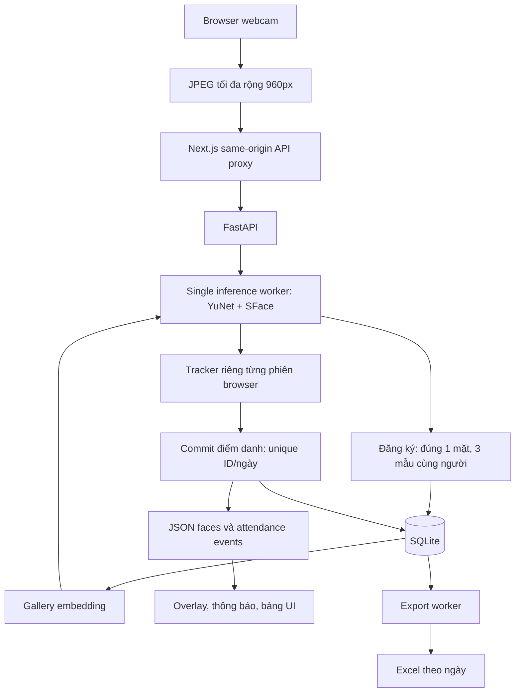

# Kiến trúc ứng dụng đã tích hợp

## Thành phần

| Thành phần | Hiện thực | Trách nhiệm |
| --- | --- | --- |
| Web UI | frontend/src/components | Đăng ký, Attendance, Members, Records, Settings |
| Browser camera | use-camera.ts | getUserMedia, chụp JPEG, stop tracks |
| Recognition client | use-recognition.ts | Lease phiên, gửi tuần tự frame, xử lý kết quả |
| Next.js proxy | app/api/[...path]/route.ts | Cùng origin, backend URL/secret server-side, giới hạn request |
| FastAPI | backend/presence_cv/api.py | Validate payload, phiên browser, API đọc/ghi/tải file |
| BaselineSession | session.py | Gallery, matching, tracking, confirmation, ghi điểm danh |
| VisionEngine | vision.py | YuNet → quality → alignCrop → SFace → 128D normalized embedding |
| Repository | storage.py | SQLite transaction, constraints, model metadata, revisions |
| Export worker | export.py | Snapshot DB → file tạm → atomic replace → cập nhật revision |

## Luồng

Browser là chủ sở hữu webcam, backend chỉ nhận ảnh. Camera đăng ký và điểm danh không chạy đồng thời trong cùng trang. Tắt camera/chuyển trang/hủy modal giải phóng media tracks.

## Xử lý và vòng đời

FastAPI lifespan nạp model một lần và tạo một executor suy luận với một thread. Mỗi browser session có BaselineSession riêng về tracker, generation và chống phát event lặp; các session chia sẻ model, repository và exporter. SQLite connection được tạo theo thao tác/thread, không chia sẻ connection đang dùng.

Client chỉ gửi frame tiếp sau khi request trước trả về, nhịp mục tiêu 200ms tùy thời gian xử lý. Camera capture giữ ảnh không mirror cho CV; preview/overlay có thể mirror. SVG overlay và video dùng cùng tỷ lệ contain.

Server cấp timestamp monotonic lúc nhận frame, kiểm tra độ mới trước/sau inference. Lease tối đa 15 giây không hoạt động; mỗi request hợp lệ làm mới lease. Tối đa 64 lease đồng thời nhằm chặn tăng bộ nhớ vô hạn. DELETE thu hồi lease ngay rồi đóng stream trên executor; kết quả bị thu hồi không được tạo yêu cầu lưu tiếp. Bản ghi đã commit trước khi dừng vẫn hợp lệ.

Web dùng max_observation_gap=1.2s và confirmation_window=2.5s để chịu khoảng cách request; baseline CLI giữ cấu hình trong default.json. Cả hai giữ ba quan sát, ít nhất 0.35s bằng chứng và max_frame_age=1s. Độ trễ mạng cloud cần đo lại.

## Đăng ký và gallery

Ba ảnh được kiểm tra riêng trước khi review, rồi kiểm tra lại khi Save. Mỗi ảnh đúng một mặt đạt quality; ba ảnh khác digest và embedding phải nhất quán cùng danh tính. Hồ sơ có mặt rất giống người đã tồn tại bị từ chối để xem lại.

Người + ba embedding float32 + model/preprocessing metadata ghi trong một transaction. Gallery root tải lại sau commit; từng stream phát hiện gallery version mới, nạp lại và reset tracking ở frame tiếp theo. Retry cùng ID, tên và đúng ba digest đã lưu là idempotent. ID trùng với nội dung khác trả conflict. Ảnh không được lưu trên đĩa ở luồng web.

## Database và Excel

| Bảng | Dữ liệu / ràng buộc |
| --- | --- |
| persons | ID chuỗi duy nhất, họ tên Unicode, ngày tạo, active |
| face_samples | FK person, embedding128 float32, metadata, digest |
| attendance | ID, tên snapshot, ngày, timestamp có timezone, Present; UNIQUE(person_id, attendance_date) |
| export_state | data_revision, exported_revision, lỗi và thời điểm xuất |

Ngày tính theo Asia/Ho_Chi_Minh từ timestamp backend. Commit tạo attendance đồng thời tăng data_revision. Excel xuất snapshot revision R sang file tạm cùng thư mục, đóng file rồi thay file đích và đánh dấu exported_revision=R. Nếu có dữ liệu mới trong lúc xuất, revision còn pending. Khóa file không làm mất điểm danh; UI báo riêng và có retry.

Download trên web dựng workbook mới từ DB theo bộ lọc, độc lập file ngày có thể đang bị Excel khóa. ID/tên được ghi kiểu text an toàn.

Mặc định dữ liệu ở backend/var; PRESENCE_DATA_DIR cho phép mount ổ đĩa riêng. Test dùng thư mục riêng. Chi tiết host tại [DEPLOYMENT](DEPLOYMENT.md).

## Giới hạn hiện tại

Một process Uvicorn với một inference worker thích hợp cho nhóm demo nhỏ. Chưa có email/password, phân quyền, liveness hoặc vận hành đa instance. Shared backend key bảo vệ kết nối Next→Python; key này không cấp quyền riêng cho từng người dùng web. Tất cả người truy cập workspace hiện có thể đọc danh sách/lịch sử và đăng ký hồ sơ. Cần thiết kế xác thực và quyền truy cập trước khi mở dịch vụ cho phạm vi rộng.
