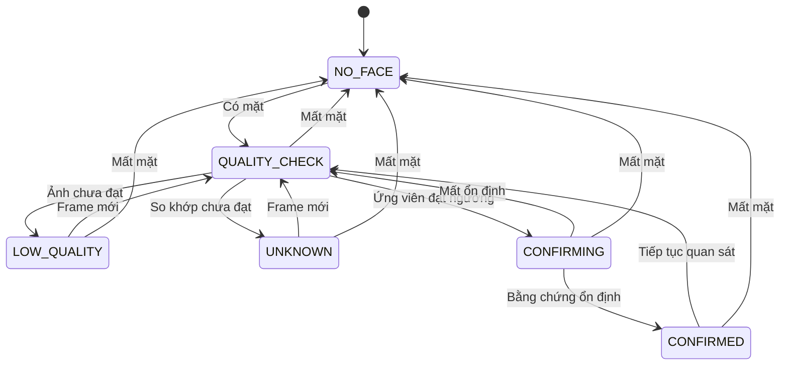

# Trạng thái và chuyển trạng thái

## Ánh xạ sang bản web

Browser giữ camera; Next/FastAPI giữ dữ liệu thật. Provider kết nối có ba trạng thái loading → ready hoặc disconnected; disconnected vô hiệu hóa thao tác ghi/nhận diện, giữ nút Retry connection. Không tạo dữ liệu mẫu khi chưa kết nối.

Đăng ký chạy Profile → Face samples → Review → Saving → Completed. Capture gửi từng ảnh lên backend và chỉ tăng số mẫu khi accepted. Review chưa ghi DB; Save mới ghi transaction. Saving khóa thao tác đóng/lưu lặp. Lỗi giữ mẫu để thử lại; retry cùng bộ mẫu đã commit không tạo thêm hồ sơ.

Recognition client có standby → opening camera → connecting lease → processing → stopped/error. Chỉ bắt đầu lease khi camera stream tồn tại. Tắt camera, chuyển trang hoặc tab bị ẩn sẽ dừng client; DELETE thu hồi lease, abort frame cũ, stop tracks. Lease hết hạn trả lỗi có thể bật lại camera.

Các state dưới đây mô tả nghiệp vụ dùng chung CLI/web; phần widget desktop được thay bằng React state và browser media lifecycle.

## Mode ứng dụng

| Mode | Ý nghĩa | Chuyển tiếp |
| --- | --- | --- |
| INITIALIZING | Kiểm tra cấu hình, model, database | ATTENDANCE hoặc SETUP_ERROR |
| ATTENDANCE | Luồng điểm danh, camera có thể tắt/bật | REGISTERING hoặc CLOSING |
| REGISTERING | Nhập thông tin và lấy mẫu | ATTENDANCE hoặc CLOSING |
| SETUP_ERROR | Thiếu model, dữ liệu lỗi hoặc cấu hình không hợp lệ | Thử lại INITIALIZING hoặc CLOSING |
| CLOSING | Dừng camera/worker, hoàn tất giao dịch | Kết thúc |

Chuyển mode tăng camera generation, xóa bằng chứng xác nhận và bỏ kết quả CV đang xử lý của mode cũ. Trong REGISTERING chỉ tạo mẫu đăng ký.

## Camera

| Từ | Sự kiện | Đến | Hành động |
| --- | --- | --- | --- |
| OFF | Bật camera | OPENING | Gọi getUserMedia trên browser; CLI dùng camera index |
| OPENING | Đọc được frame | RUNNING | Cho phép xử lý |
| OPENING | Mở thất bại | ERROR | Hiển thị cách thử lại |
| RUNNING | Tắt camera | STOPPING | Vô hiệu kết quả cũ, ngừng đọc |
| RUNNING | Mất thiết bị/đọc lỗi liên tục | ERROR | Giải phóng thiết bị và báo lỗi |
| STOPPING | Đã đóng thiết bị | OFF | Hiện màn hình camera tắt |
| ERROR | Thử lại | OPENING | Tạo generation mới |
| ERROR | Dừng | OFF | Kết thúc lần thử |

Chỉ báo RUNNING sau frame đầu tiên. Nút bật/tắt được vô hiệu phù hợp trong OPENING/STOPPING để tránh thao tác trùng.

## Nhận diện theo từng mặt

CONFIRMED tạo một yêu cầu điểm danh cho lần xác nhận đó. Giữ trạng thái phản hồi đã điểm danh trên UI và hạn chế phát yêu cầu liên tục khi người đó đứng yên. Database vẫn kiểm tra trùng cho mọi yêu cầu.

Khi tracking mơ hồ, frame quá cũ, camera dừng, gallery đổi hoặc ứng viên ID đổi, reset lịch sử. Số lần xác nhận và thời hạn lịch sử là cấu hình phải đo trong kiểm thử.

## Điểm danh

| Trạng thái | Kết quả | Phản hồi |
| --- | --- | --- |
| IDLE | Chưa có yêu cầu | Chờ nhận diện |
| SAVING | Đang xử lý transaction | Tránh lặp thao tác cùng ID |
| CREATED | Commit bản ghi mới | “Điểm danh thành công” và thêm hàng UI |
| ALREADY_EXISTS | ID đã có bản ghi trong ngày | “Đã điểm danh hôm nay” |
| FAILED | Transaction thất bại | Báo chưa lưu, cho phép thử lại |

CREATED/ALREADY_EXISTS/FAILED kết thúc một yêu cầu. Kết quả trả về chứa ngày và timestamp đã lưu, UI dùng đúng bản ghi đó.

## Đăng ký

| Bước | Điều kiện chuyển tiếp | Trường hợp cần xử lý |
| --- | --- | --- |
| EDITING | ID và tên hợp lệ | ID trống/trùng, tên trống |
| CAPTURING | Camera RUNNING | Camera lỗi, nhiều mặt |
| REVIEWING | Đủ ba mẫu hợp lệ | Cho chụp lại bộ ba mẫu |
| SAVING | Người dùng bấm lưu | Vô hiệu lưu lặp |
| COMPLETED | Transaction và gallery cập nhật thành công | Quay về điểm danh |
| SAVE_ERROR | Transaction lỗi | Giữ mẫu tạm để thử lại |

Ảnh chưa đạt bị từ chối và giữ ở CAPTURING. Có thể hủy trước SAVING để bỏ mẫu tạm. Khi đang SAVING, chờ kết quả giao dịch trước khi chuyển mode. Sau lưu mà việc reload gallery lỗi, báo hồ sơ đã lưu và tạm ngừng nhận diện đến khi reload thành công.

## Xuất Excel theo ngày

| Trạng thái | Điều kiện |
| --- | --- |
| SYNCED | exported_revision bằng data_revision và file tồn tại |
| PENDING | Có dữ liệu mới hoặc cần tái tạo file |
| EXPORTING | Đang dựng snapshot |
| EXPORT_ERROR | Lỗi ghi/thay file, tiếp tục giữ pending |

Thành công xuất revision R chỉ chuyển SYNCED nếu R còn là revision mới nhất. Nút thử lại dùng dữ liệu đã lưu. Giao diện có thể đồng thời hiển thị “Điểm danh thành công” và “Excel đang chờ cập nhật”.
